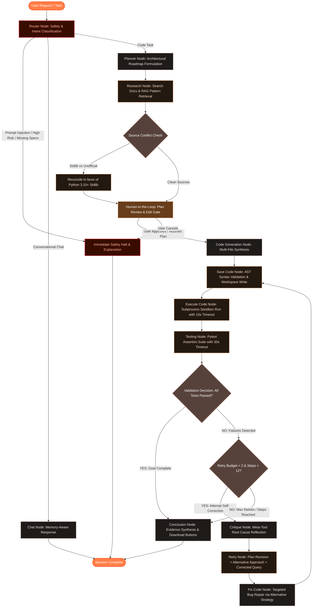

# Ola — Autonomous AI Code & Engineering Agent Studio

**Ola** is an autonomous AI software engineer built on **LangGraph ReAct**. Ola accepts complex natural language coding tasks, researches official documentation and design patterns, formulates step-by-step architectural roadmaps, awaits Human-in-the-Loop (HITL) approval, writes AST-validated Python applications with comprehensive pytest suites, executes them in sandboxed subprocess environments, and self-corrects through automated failure reflection and alternative algorithmic strategies.

---

##  Table of Contents
1. [Architecture Diagram](#-architecture-diagram)
2. [Workflow & Execution Lifecycle](#-workflow--execution-lifecycle)
3. [Agent Pattern](#-agent-pattern)
4. [Tool Categories & Taxonomy](#-tool-categories--taxonomy)
5. [State Management & Memory](#-state-management--memory)
6. [Stopping Rules & Guardrails](#-stopping-rules--guardrails)
7. [Retries & Self-Correction](#-retries--self-correction)
8. [Reliability, Safeguards & Fallbacks](#-reliability-safeguards--fallbacks)
9. [Quickstart & Setup Instructions](#-quickstart--setup-instructions)
10. [REST API Reference](#-rest-api-reference)

---

##  Architecture Diagram



---

##  Workflow & Execution Lifecycle

1. **User Prompt Ingestion:** User sends a task via the Web UI or API endpoint.
2. **Safety & Ambiguity Gate:**
   - Checks for **Prompt Injection** (instruction override, jailbreaks, prompt leaks).
   - Checks for **High Risk Operations** (path traversal `../`, root modifications, destructive shell calls).
   - Checks for **Missing Information** (ambiguous prompts lacking specifications).
3. **Intent Routing:** Categorizes inputs into `chat` (interactive conversation) or `code` (software build).
4. **Architectural Planning:** Meta-tool `manage_plan` decomposes the task into 3–6 verifiable milestone steps.
5. **Search & Knowledge Retrieval (RAG):**
   - Queries official Python documentation (`pydoc`, PyPI API).
   - Queries curated technical pattern store (algorithms, testing idioms, clean contracts).
   - Reconciles conflicting information by prioritizing standard library rules.
6. **Human-in-the-Loop (HITL) Gate:** The execution stream pauses before code generation, presenting the architectural roadmap to the human developer. The developer can approve, modify, or reject the plan.
7. **Code Synthesis & AST Validation:**
   - Synthesizes modular application code and matching pytest suites.
   - Parses code with Python's `ast.parse` prior to disk write to ensure zero syntax or indentation errors.
8. **Subprocess Execution & Testing:**
   - Runs application code in an isolated subprocess with a 10-second timeout guard.
   - Runs `pytest -v` with assertion parsing and a 30-second timeout guard.
9. **Decision & Reflection Loop:**
   - If tests pass: Transitions to `conclusion_node` (`stop_reason = "goal_complete"`).
   - If tests fail: Enters self-correction (max 2 retries). Analyzes failure tracebacks, reformulates an alternative approach and corrected query, revises the plan, and patches code.
10. **Delivery & Artifact Download:** Concludes with cited evidence, verified decisions, and instant one-click download buttons for generated files.

---

##  Agent Pattern

Ola follows an **Extended Plan-and-Execute ReAct Pattern** augmented with:
- **State Machine Topology:** Built using LangGraph `StateGraph`, maintaining deterministic transitions and conditional branching.
- **Human-in-the-Loop Interrupts:** Uses LangGraph's checkpointer to pause execution before code generation and resume seamlessly on human input.
- **Reflection & Self-Correction:** When tests fail, a dedicated `critique_node` performs root-cause diagnostics, and `retry_node` explicitly pivots to a different algorithmic strategy rather than repeating failed attempts.
- **Multi-Turn Persistent Memory:** LangGraph `MemorySaver` preserves the conversation thread across multiple user messages, enabling context-aware follow-ups and refinements.

---

##  Tool Categories & Taxonomy

Every tool call returns a structured schema: `success: bool`, `validated: bool`, `validation_summary: str`, and `evidence: dict`.

| Category | Tool | Description | Safety / Timeout Guard |
| :--- | :--- | :--- | :--- |
| **Search & Knowledge** | `search_python_docs` | Searches standard library docstrings & PyPI package registry | Cleaned pydoc formatting, 5s HTTP timeout |
| **Search & Knowledge** | `rag_code_knowledge` | Retrieves curated algorithmic & testing patterns | Token-overlap relevance scoring |
| **System & Environment** | `write_file` | Writes files to workspace directory | `ast.parse` syntax pre-validation, sandboxed path checks |
| **System & Environment** | `read_file` | Reads workspace file content | Sandboxed relative path validation |
| **System & Environment** | `list_files` | Lists directory contents | Ignores cache and private directories |
| **Code & Compute** | `execute_python` | Runs Python script in subprocess | **10-second** timeout, captures stdout/stderr |
| **Code & Compute** | `run_tests` | Executes pytest test suite | **30-second** timeout, regex assertion parsing |
| **Meta-Tools** | `update_plan` | Manages milestone steps & active step tracking | Structured plan tracking |
| **Meta-Tools** | `critique_test_failure` | Diagnoses runtime exceptions & assertion tracebacks | Heuristic & traceback root-cause classifier |
| **Security & Robustness**| `detect_prompt_injection`| Scans input for adversarial override attempts | Regex pattern heuristics |
| **Security & Robustness**| `detect_high_risk_operation`| Scans for destructive system commands | Blocks `rm -rf`, path traversal, raw shell pipes |
| **Security & Robustness**| `reconcile_conflicting_sources`| Identifies conflicting recommendations | Prefers official stdlib specifications |

---

##  State Management & Memory

The entire workflow state is tracked using a `TypedDict` schema in [`agent/state.py`](agent/state.py):

```python
class AgentState(TypedDict, total=False):
    task: str                               # Current user request
    chat_history: list[dict[str, str]]       # Multi-turn conversational memory
    intent: str                             # "chat" vs "code"
    chat_response: str                      # Conversational response
    plan: list[str]                         # Active implementation milestones
    plan_history: list[dict[str, Any]]      # Plan evolution across retries
    current_step: int                       # Current milestone index
    step_count: int                         # Total workflow steps executed
    max_steps: int                          # Maximum step budget (default: 12)
    stop_reason: Optional[str]              # "goal_complete" | "information_missing" | "risk_too_high" | etc.
    files: list[str]                        # File paths created in workspace
    generated_code: dict[str, str]          # Filename -> Source code mapping
    evidence: list[dict[str, Any]]          # Cited documentation and search evidence
    tool_validations: list[dict[str, Any]]  # Empirical tool execution records
    decision_explanations: list[str]        # Explanations for key decisions
    execution_output: str                   # stdout / stderr from subprocess
    test_output: str                        # Pytest stdout / failure tracebacks
    execution_success: bool                 # Exit code == 0
    tests_passed: bool                      # All unit test assertions passed
    critique: Optional[dict[str, Any]]      # Failure diagnosis and fix strategy
    errors: list[str]                       # Logged errors
    retry_count: int                        # Self-correction iterations (0, 1, 2)
    alternative_approach: Optional[str]     # Strategy pivoted to on retry
    corrected_query: Optional[str]          # Query adjusted for retry
    conflicting_sources: list[str]          # Recorded conflict resolutions
    status: str                             # Current node execution status
    final_response: str                     # Synthesized report to user
```

State is persisted across turns using LangGraph's **`MemorySaver` checkpointer** keyed by `thread_id`.

---

##  Stopping Rules & Guardrails

The agent deterministically stops when any of the following 5 conditions are met:

1. **Goal Complete:** Application code executes with returncode 0 and all pytest test assertions pass cleanly (`tests_passed == True`).
2. **Information Missing:** If the user prompt is ungrounded, empty, or lacks necessary problem parameters, the agent halts and requests clarification instead of guessing.
3. **Risk Too High:** If adversarial prompt injection patterns or dangerous destructive operations (e.g. system file modification) are detected, execution is immediately aborted with a safety explanation.
4. **Max Steps Reached:** A workflow step budget (default 12 steps) ensures the agent never enters an unbounded or recursive loop.
5. **Max Retries Reached:** If tests fail after 2 self-correction iterations, the agent halts, summarizes the remaining failure tracebacks, and invites developer inspection.

---

## Retries & Self-Correction

- **Maximum 2 Retries:** Enforced in `check_test_results` conditional routing.
- **No Blind Repetition:** Each retry must formulate:
  1. **An Alternative Approach:** (e.g., switching from recursion to iteration, adding defensive boundary checks, or using specialized data structures).
  2. **A Corrected Search Query:** A targeted search query addressing the specific exception type.
  3. **Plan Revision:** Appends the alternative approach to `plan_history` and logs `[PLAN_REVISED]`.
- **Targeted Code Repair:** `fix_code_node` supplies the alternative strategy and critique recommendations directly to the synthesizer.

---

## 🛡️ Reliability, Safeguards & Fallbacks

- **Unreliable Sources & Conflict Resolution:** When search tools return conflicting advice, `reconcile_conflicting_sources` filters and prioritizes official standard library rules.
- **Execution Sandboxing:** All filesystem interactions are confined to the dedicated `workspace/` directory via `get_safe_path`. Access to parent directories (`../`) is strictly rejected.
- **Subprocess Timeout Guards:** Script execution is capped at **10 seconds** and pytest runs at **30 seconds** to gracefully handle infinite loops or deadlocks.
- **AST Pre-Validation:** Python code is checked via `ast.parse` before writing to disk, ensuring malformed code never reaches the workspace.
- **Persistent Structured Logging:** All agent actions, transitions, tool choice reasons, failure reflections, and state updates are recorded in `logs/ola_agent.log` (5 MB rotation, 5 backups).

---

##  Quickstart & Setup Instructions

### Prerequisites
- **Python 3.10+**
- **Node.js 18+** & `npm`
- **Linux / macOS / WSL2**

### 1. Clone & Environment Setup
```bash
git clone <repository_url>
cd code_agent

# Create and activate Python virtual environment
python3 -m venv .venv
source .venv/bin/activate

# Install Python dependencies
pip install -r requirements.txt
```

### 2. Configure Environment Variables
Create or verify your `.env` file in the project root:
```env
GEMINI_API_KEY="your-api-key-here"
GEMINI_MODEL="gemini-2.5-flash"
WORKSPACE_DIR="./workspace"
```

### 3. Install Frontend Dependencies
```bash
cd frontend
npm install
cd ..
```

### 4. Run the Application
Launch both backend and frontend with one command:
```bash
./start.sh
```

- **Web UI:** [http://localhost:3000](http://localhost:3000)
- **FastAPI Docs:** [http://localhost:8000/docs](http://localhost:8000/docs)
- **Live Logs:** `tail -f logs/ola_agent.log`

---

##  REST API Reference

| Method | Endpoint | Description |
| :--- | :--- | :--- |
| `POST` | `/api/chat` | Initiate task or send message (Server-Sent Events streaming) |
| `POST` | `/api/chat/resume` | Resume paused thread on human approval/update/rejection |
| `GET` | `/api/chat/history` | Retrieve full multi-turn conversation memory for a thread |
| `GET` | `/api/workspace/files` | List all files in the sandboxed workspace |
| `GET` | `/api/workspace/file` | Inspect content of a specific workspace file |
| `GET` | `/api/workspace/file/download` | Download a specific generated file directly |
| `GET` | `/api/workspace/download` | Download all workspace files as a `.zip` archive |
| `GET` | `/api/logs` | Fetch live agent execution log lines |
| `GET` | `/api/health` | Healthcheck and active workspace path |
